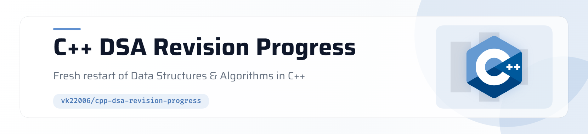

<picture>
   <source media="(prefers-color-scheme: dark)" srcset="img/header-dark.png">
   
</picture>


## Goal

* Rebuild DSA from fundamentals
* Improve problem solving and implementation skills
* Prepare for placements
* Improve code quality for project development
* Build consistency through daily progress


## Current Status

Progress: 🟡 Restart Phase

Topics Completed:

* [x] C++ Basics
* [x] Arrays
* [x] Strings
* [x] Sorting
* [x] Binary Search
* [x] Math
* [x] Hashing
* [x] Prefix Sum
* [x] Sliding Window
* [ ] Stack
* [ ] Queue
* [ ] Linked List
* [x] Trees
* [x] Sets
* [ ] Heap
* [ ] Graph
* [x] Dynamic Programming


## Structure

```text
.
├── Arrays/
├── Binary_Search/
├── Bitwise_Manipulation/
├── Code_Templates/
├── Dynamic_Programming/
    └── Kadane's/
├── Greedy/
    └── Knapsack/
├── Hash_Maps/
├── Math/
├── Notes/
├── Prefix_Sum/
├── Sliding_Window/
├── Sorting/
├── STL/
├── Strings/
├── Trees/
└── README.md
```

## Problem Solving Rules

1. Understand problem
2. Write brute force
3. Optimize
4. Implement without copy-paste
5. Revisit after few days


## Goals

Short Term:

* Become comfortable with medium problems
* Improve implementation speed

Long Term:

* Strong DSA foundation
* Better software engineering thinking
* Placement readiness
* Stronger C++ development skills

---

Started: June 2026
Language: C++
